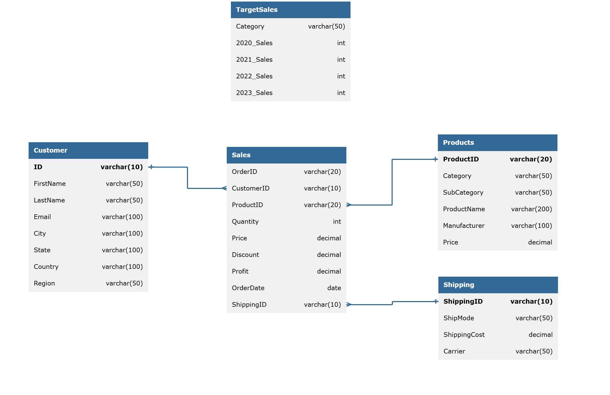

# SQL_Case_Superstore
# Sales Analysis (MySQL)

SQL analysis of a retail sales database covering customers, products, orders, and shipping. The queries answer business questions on top customers, monthly sales, product performance, customer acquisition, profit margins, and order history.

**Dataset at a glance:** 8,027 sales rows · 783 customers · 1,810 products

## Database Schema



| Table | Description |
|---|---|
| `Sales` (fact) | One row per sale: customer, product, quantity, price, discount, profit, order date, shipping |
| `Customer` | Name, email, city, state, country, region |
| `Products` | Category, subcategory, product name, manufacturer, price |
| `Shipping` | Ship mode, shipping cost, carrier |
| `TargetSales` | Sales targets by category for 2020-2023 (standalone table, not linked by a key) |

## Tools

- MySQL 8
- MySQL Workbench

## Questions Answered

| # | Question | Key Techniques |
|---|---|---|
| 1 | Top 10 customers by total sales amount | Joins, `SUM`, `ORDER BY`, `LIMIT` |
| 2 | Total sales per month for 2023 | `DATE_FORMAT`, aggregation, date filtering |
| 3 | Products that have never been sold | `LEFT JOIN` anti-join (`IS NULL`) |
| 4 | New customers acquired in 2022 | Subquery, `MIN()`, `HAVING` |
| 5 | Profit margin % by product category | Aggregation, `CAST`, joins |
| 6 | Daily sales per category with a running total | CTE, window `SUM() OVER`, `ROWS BETWEEN UNBOUNDED PRECEDING AND CURRENT ROW` |
| 7 | Most recent order for every customer | Window ranking with `PARTITION BY`, handling ties |

More questions are being added.

## Definitions

- Total sales is calculated as `SUM(Price)` from the `Sales` table.
- Profit margin is `SUM(Profit) / SUM(Price) * 100`.
- A customer's acquisition date is the date of their first order.

## SQL Concepts Practiced

- Joins across a fact table and dimension tables
- Anti-joins to find records with no match
- CTEs and subqueries
- Window functions: running totals and ranking
- Date functions: `DATE_FORMAT`, `YEAR`
- Percentage calculations and rounding with `CAST`

## Repository Structure

```
├── README.md
├── database_diagram.png
└── superstoresales_analysis_queries.sql
```

## How to Run

1. Create the database and load the source tables.
2. Run the queries in `superstoresales_analysis_queries.sql`.

